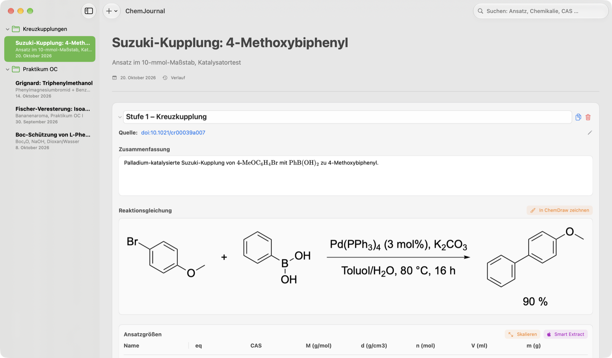

# ChemJournal

**Elektronisches Laborjournal für die Synthesechemie – nativ auf dem Mac, auch für Linux.**

ChemJournal ordnet deine Synthesen nach Projekt, Ansatz und Stufe: Ansatzgrößen-Tabellen, die selbst rechnen,
Reaktionsgleichungen, Vorschriften mit chemischen Formeln, Ausbeuten und Analysedateien – und bei Bedarf alles
als sauberes PDF.

🇬🇧 [English version](README.md)

> 🤖 **Mit KI entwickelt:** ChemJournal wurde mithilfe von **Google Gemini Flash 3.8** und **Claude Opus 5.5**
> (Anthropic) programmiert. Mehr dazu unter [Wie die App entstanden ist](#wie-die-app-entstanden-ist).



## Download

Die aktuelle Version gibt es unter **[Releases](../../releases/latest)**:

| System | Datei |
|---|---|
| macOS 15 (Sequoia) oder neuer, Apple-Chip und Intel | `ChemJournal-1.0.0-macOS.dmg` |
| Linux x86_64 (die meisten PCs) | `ChemJournal-1.0.0-x86_64.AppImage` |
| Linux ARM64 | `ChemJournal-1.0.0-arm64.AppImage` |
| Linux als Archiv | `ChemJournal-1.0.0-x64.tar.gz` / `…-arm64.tar.gz` |

**macOS:** .dmg öffnen und ChemJournal in den Ordner *Programme* ziehen. Die App ist nicht von Apple beglaubigt
(dafür bräuchte es ein kostenpflichtiges Entwicklerkonto). Beim ersten Start blockiert macOS sie deshalb einmal:
*Systemeinstellungen › Datenschutz & Sicherheit* öffnen und **Dennoch öffnen** klicken.

**Linux:** AppImage ausführbar machen und starten, keine Installation nötig:

```bash
chmod +x ChemJournal-1.0.0-x86_64.AppImage
./ChemJournal-1.0.0-x86_64.AppImage
```

Zum Ausprobieren mit Daten: einen der [Beispiel-Ansätze](examples/) über
*Ablage › Ansatz importieren (.chemjournal)* laden.

## Funktionen

- **Projekte → Ansätze → Stufen**, Ansätze per Drag & Drop verschieben, Volltextsuche
- **Ansatzgrößen, die rechnen:** Masse, Volumen oder Stoffmenge eingeben, der Rest folgt aus Molmasse, Dichte und
  Äquivalenten; ändert sich der Leit-Reaktand, rechnen alle Zeilen mit; ganzen Ansatz skalieren
- **CAS-Autofill:** CAS-Nummer eintippen, Molmasse und Dichte kommen aus PubChem – und werden lokal gespeichert,
  beim nächsten Mal also sofort und auch offline eingetragen
- **Smart Extract:** Vorschrift aus einem Paper oder einer SI einfügen, die Tabelle füllt sich (Deutsch und Englisch)
- **Formeln:** `$…$` (LaTeX) und `\ce{…}` (mhchem) in Zusammenfassung, Vorgehen und Beobachtung, automatisch
  gesetzt beim Verlassen des Feldes, komplett offline
- **Suche nach Chemikalien:** `n-BuLi` findet auch „n-Butyllithium“, „BuLi“ und Zeilen, die nur CAS 109-72-8 haben
- **Ausbeute** gegen einen wählbaren Bezugs-Reaktanden, mit theoretischer Masse
- **PDF-Export** auf A4 mit Seitenzahlen, je Ansatz oder für ein ganzes Projekt
- **Versionsverlauf je Ansatz**, tägliche Backups, gelöschte Ansätze wiederherstellen, Rückgängig/Wiederholen
- **Sync** über iCloud Drive (macOS) oder einen Sync-Ordner wie Nextcloud/Dropbox (Linux) – gleiches Dateiformat
- Hell- und Dunkelmodus

## Smart Extract

Erst werden typische Artefakte aus PDF-Kopien repariert (verklebte Wörter, `•C` statt `°C`, Silbentrennung), dann
liest ein regelbasierter Parser Zahl + Einheit, ignoriert Temperaturen, Zeiten, Konzentrationen, Kolbengrößen und
Aufarbeitungsschritte und ordnet die Mengen den Namen zu. Was ein Chemikalienname ist, entscheidet ein kleines
Modell, trainiert auf synthetischen Sätzen (Create ML auf dem Mac, gleichwertiger Klassifikator unter Linux).

Gemessen an von Hand annotierten Absätzen aus echten Veröffentlichungen: **100 % der Zeilen richtig** (33/33
öffentliche Fälle). Alles läuft lokal – kein Text verlässt deinen Rechner.

## Datenschutz

Das Journal ist eine JSON-Datei auf deinem Rechner (oder im Sync-Ordner). Die einzige Netzwerkanfrage ist die
PubChem-Suche, und die enthält nur die eingetippte CAS-Nummer.

## Selbst bauen

**macOS:** Xcode 27 oder neuer, `macos/ChemJournal.xcodeproj` öffnen, ⌘R. **Linux:** Node.js 24, siehe
[`linux/README.md`](linux/README.md).

## Wie die App entstanden ist

ChemJournal ist ein KI-gestütztes Projekt: Der Code der Mac-App, der Linux-Version, von Smart Extract und des
Trainingsdaten-Generators wurde mit **Google Gemini Flash 3.8** und **Claude Opus 5.5** (Anthropic) geschrieben.
Idee, Anforderungen aus dem Laboralltag und alle Entscheidungen kommen von mir.
Jede Funktion ist durch automatische Tests abgedeckt (76 unter macOS, 10 unter Linux) und durch das
Smart-Extract-Testkorpus.

## Lizenz

[MIT](LICENSE). Mitgelieferte Software: MathJax, htm, pdf.js (Apache 2.0), Preact, Electron (MIT).
Privates Projekt, ohne Verbindung zu Apple, PubChem oder Verlagen. Berechnete Mengen vor dem Einwiegen bitte
immer gegenprüfen.
