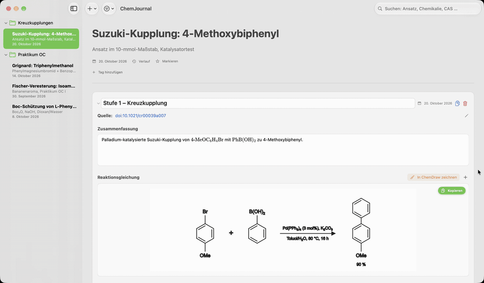
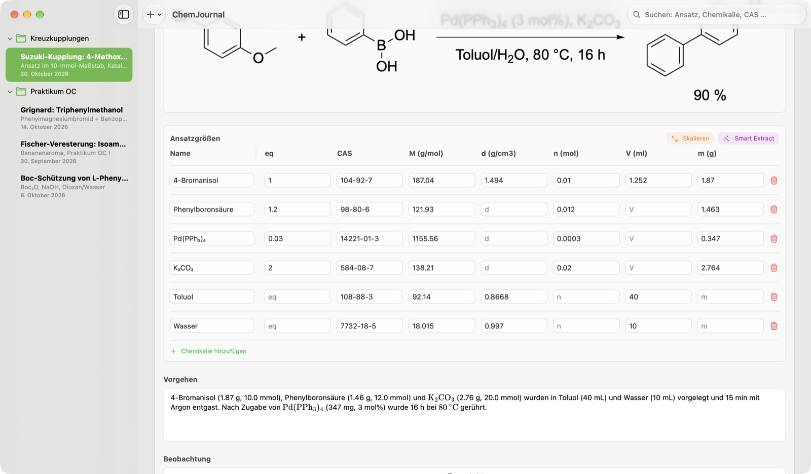
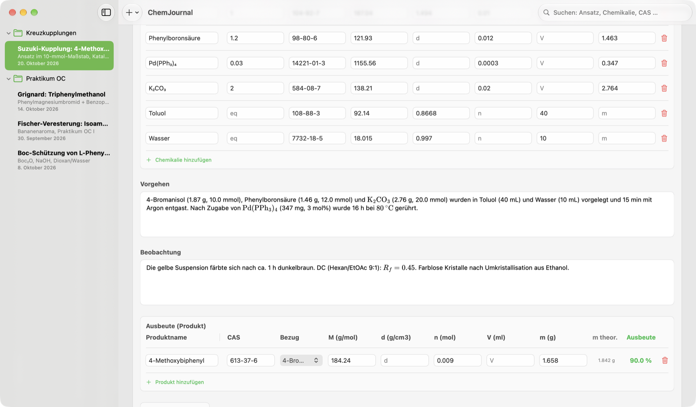
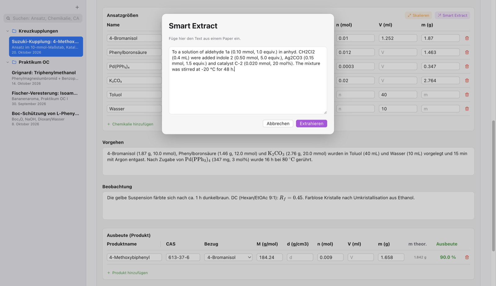
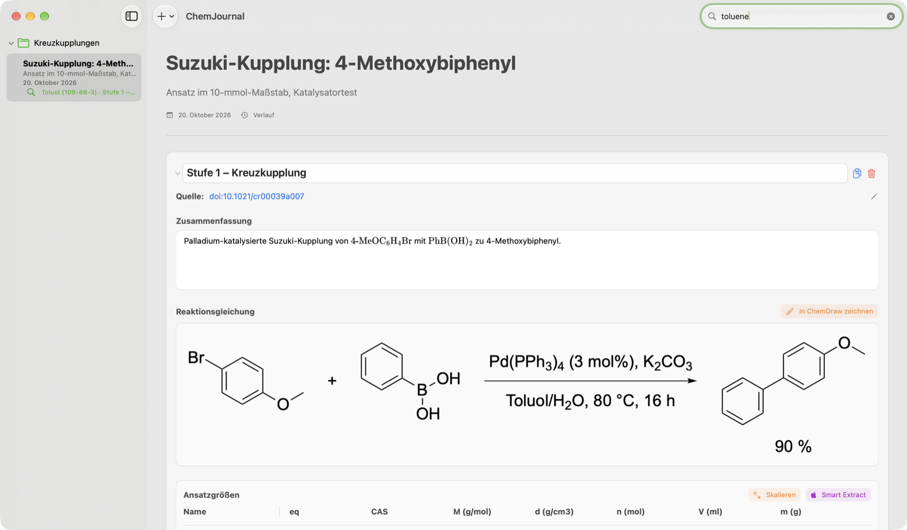
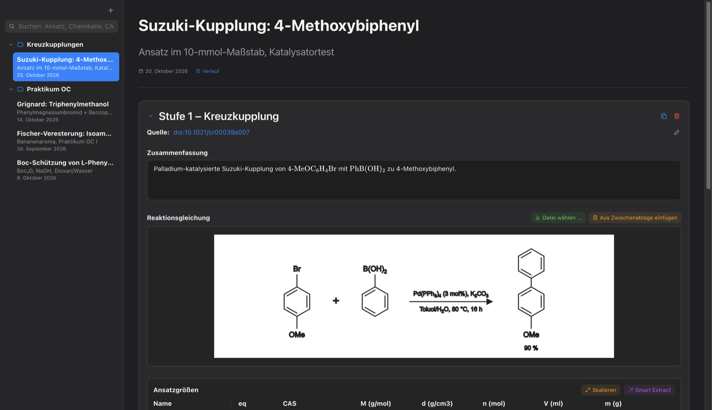
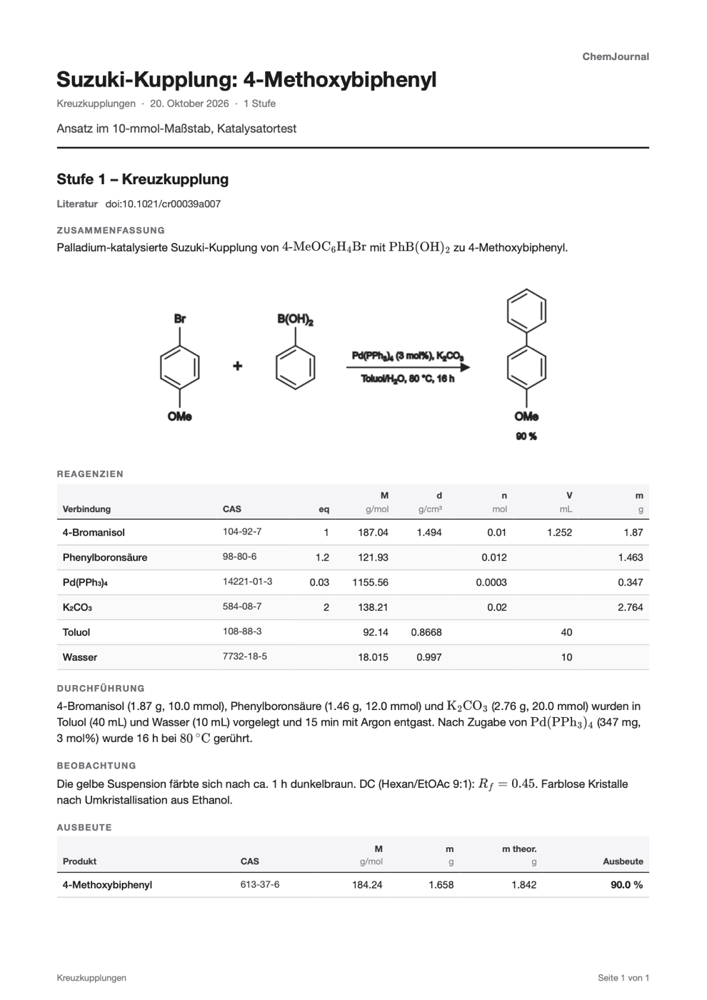
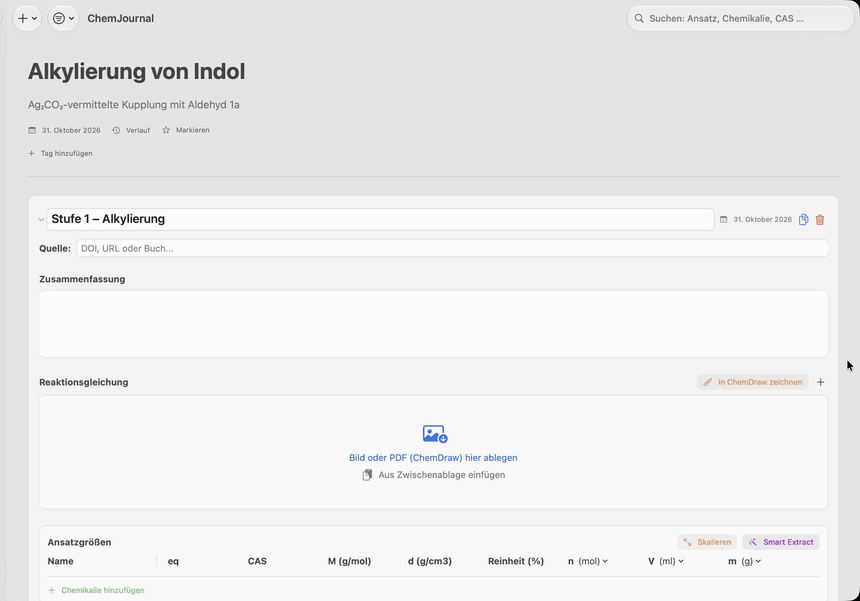

# ChemJournal

**An electronic lab notebook for synthetic chemistry – native on macOS, also available for Linux.**

ChemJournal keeps your syntheses organised by project, experiment and stage: reagent tables that calculate
themselves, reaction schemes, procedures with chemical formulas, yields, analysis files – and it turns everything
into a clean PDF when you need it on paper.

> The user interface is in **German** by default and available in **English** (*Settings › General › Language*). 🇩🇪 [Deutsche Version dieser Seite](README.de.md)

> 🤖 **Built with AI:** ChemJournal was programmed with the help of **Google Gemini Flash 3.8** and
> **Claude Opus 5.5** (Anthropic). See [How this app was made](#how-this-app-was-made).


### See it in action

[](docs/ChemJournal-Demo.mp4)

<sub>50-second tour in real time – click for the full-resolution video at 60 fps
([MP4](docs/ChemJournal-Demo.mp4)).</sub>

## Download

Get the latest version from the **[Releases page](../../releases/latest)** – what's new is in the
**[changelog](CHANGELOG.md)**:

| System | Version | File |
|---|---|---|
| macOS 15 (Sequoia) or newer, Apple Silicon and Intel | 1.1 | `ChemJournal-1.1-macOS.dmg` |
| Linux x86_64 (most PCs) | 1.0.3 | `ChemJournal-1.0.3-x86_64.AppImage` |
| Linux ARM64 | 1.0.3 | `ChemJournal-1.0.3-arm64.AppImage` |
| Linux, as plain archive | 1.0.3 | `ChemJournal-1.0.3-x64.tar.gz` / `…-arm64.tar.gz` |

> **Linux:** version 1.1 is macOS-only for now; the Linux files are in [release 1.0.3](../../releases/tag/v1.0.3).
> Linux 1.1 will follow. Until then, don't open a journal edited with macOS 1.1 in Linux 1.0.3 – it would drop the
> new fields (purity, marks, tags, purification & analysis) when saving.

**macOS:** open the .dmg and drag ChemJournal into *Applications*. The app is not notarised by Apple (that needs a
paid developer account), so on first launch macOS will block it once: open *System Settings › Privacy & Security*
and click **Open Anyway**.

**Linux:** make the AppImage executable and start it – no installation needed:

```bash
chmod +x ChemJournal-1.0.3-x86_64.AppImage
./ChemJournal-1.0.3-x86_64.AppImage
```

Want to try it with data? Import one of the [example experiments](examples/) via
*Ablage › Ansatz importieren (.chemjournal)*.

## Features

- **Projects → experiments → stages**, each stage with its own date, drag & drop between projects and a full-text journal search
- **Reagent table that does the maths:** enter mass, volume or amount and the rest follows from molar mass,
  density, purity and equivalents; change the limiting reagent and every other row is recalculated; scale a whole
  experiment by a factor; click a column's unit to switch between mol/mmol/µmol, ml/µl or g/mg (macOS)
- **CAS autofill:** type a CAS number and the molar mass and density are looked up on
  [PubChem](https://pubchem.ncbi.nlm.nih.gov) – and stored locally, so they appear instantly (and offline) next time
- **Smart Extract:** paste an experimental procedure from a paper or SI and get the reagent table filled in
  (German and English, see below)
- **ChemDraw or ReShiki (macOS):** click *In ChemDraw zeichnen*, draw the reaction scheme and press ⌘S – it lands in
  the experiment as a high-resolution image (the scheme in the screenshots was made this way) and stays editable for
  7 days. The free, open-source [ReShiki](https://reshiki.com) works the same way. Without either, just drop in or
  paste any image or PDF
- **Purification & analysis (macOS):** forms for NMR, IR, UV/Vis, EPR, MS, XRD, column chromatography, TLC, GC,
  recrystallisation, distillation, melting point and optical rotation – with linked spectra, calculated values
  (Δ ppm, ε, recovery, [α]) and a one-line summary for the experimental section and the PDF
- **Marks and tags (macOS):** star important experiments, give them your own tags and filter the sidebar
- **Formulas:** write `$…$` LaTeX or `\ce{…}` (mhchem) in summaries, procedures and observations – rendered
  automatically when you leave the field, entirely offline (bundled MathJax)
- **Search by chemical:** `n-BuLi` also finds “n-Butyllithium”, “BuLi” and rows that only carry CAS 109-72-8
- **Yields** against a chosen reference reagent, including theoretical mass
- **PDF export** on A4 with page numbers, one PDF per experiment or one for a whole project
- **Version history per experiment**, daily backups that you can **restore with one click**, restore deleted experiments, undo/redo for everything
- **German or English interface** – German by default, switchable in the settings
- **Sync** via iCloud Drive (macOS) or any synced folder such as Nextcloud or Dropbox (Linux) – the file format
  is the same on both platforms
- Light and dark mode

| | |
|---|---|
|  |  |
|  |  |
|  |  |

<sub>Screenshots and video: the macOS app (version 1.0) with example data. Linux 1.0.3 has the features of macOS
1.0.3 and the same file format.</sub>

## Smart Extract

Smart Extract turns a procedure like

> To a solution of aldehyde **1a** (0.10 mmol, 1.0 equiv.) in anhyd. CH₂Cl₂ (0.4 mL) were added indole **2**
> (0.50 mmol, 5.0 equiv.) and Ag₂CO₃ (0.15 mmol, 1.5 equiv.) …

into table rows (name, equivalents, amount, volume, mass). It first repairs typical copy-from-PDF artefacts
(glued words, `•C` instead of `°C`, hyphenation), then a rule-based parser reads number + unit, ignores
temperatures, times, concentrations, flask sizes and work-up steps, and assigns quantities to names. Deciding
*what is a chemical name* is done by a small model trained on synthetic sentences (Create ML word tagger on
macOS, an equivalent n-gram classifier on Linux).

[](docs/Smart-Extract-Demo.mp4)

<sub>The paragraph above in the app, in real time: temperature, reaction time and work-up are ignored
([MP4](docs/Smart-Extract-Demo.mp4)).</sub>

Measured on hand-annotated paragraphs from real papers (`macos/Tools/SmartExtractEval`): **100 % of rows
correct** (33/33 public cases, 146 rows; also 58/58 on the larger private corpus). On 95 further paragraphs from
2024/25 open-access articles (CC BY 4.0, via Europe PMC), the 28 held-out ones that were never looked at during
development come out at **85.7 % of rows completely correct on macOS and 87.5 % on Linux** (before 1.0.3: 83.0 % /
83.9 %). Everything runs locally – no text leaves your computer.

## Privacy

Your journal is a JSON file on your computer (or in your sync folder). The only network request ChemJournal
makes is the PubChem lookup, which sends nothing but the CAS number you typed.

## Building from source

**macOS** – Xcode 27 or newer, then open `macos/ChemJournal.xcodeproj` and run (⌘R). Tests: ⌘U, or

```bash
xcodebuild -project macos/ChemJournal.xcodeproj -scheme ChemJournal test
```

**Linux** – Node.js 24, see [`linux/README.md`](linux/README.md):

```bash
cd linux && npm install && npm run vendor && npm start
```

## Repository layout

```
macos/      SwiftUI app (Xcode project), tests, Smart Extract evaluation tool
linux/      Electron app with the same features and file format
training/   Generator for the Smart Extract training data (synthetic sentences) and the data itself
examples/   Example experiments to import
docs/       Screenshots and demo video
```

## How this app was made

ChemJournal is an AI-assisted project: the code for the macOS app, the Linux version, Smart Extract and the
training-data generator was written with **Google Gemini Flash 3.8** and **Claude Opus 5.5** (Anthropic). The idea,
the requirements from day-to-day lab work and all decisions come from me.
Every feature is covered by automated tests (118 on macOS, 10 on Linux) and the Smart Extract evaluation corpus.

## License

ChemJournal is released under the [MIT License](LICENSE). Bundled third-party software: MathJax (Apache 2.0),
Preact (MIT), htm (Apache 2.0), pdf.js (Apache 2.0), Electron (MIT) – license texts in
`linux/src/renderer/vendor/` and `macos/ChemJournal/Resources/MathJax/`.

ChemJournal is a personal project, not affiliated with Apple, PubChem or any publisher. Always double-check
calculated quantities before you weigh anything out.
